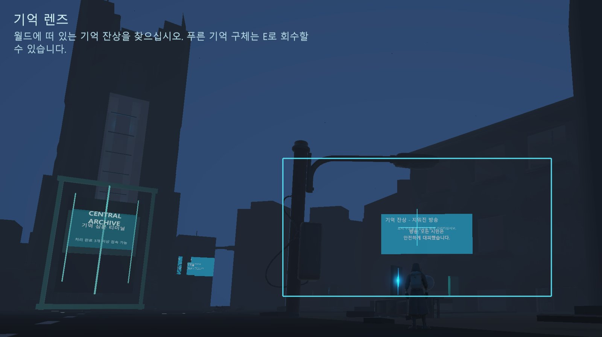
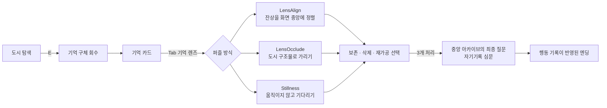
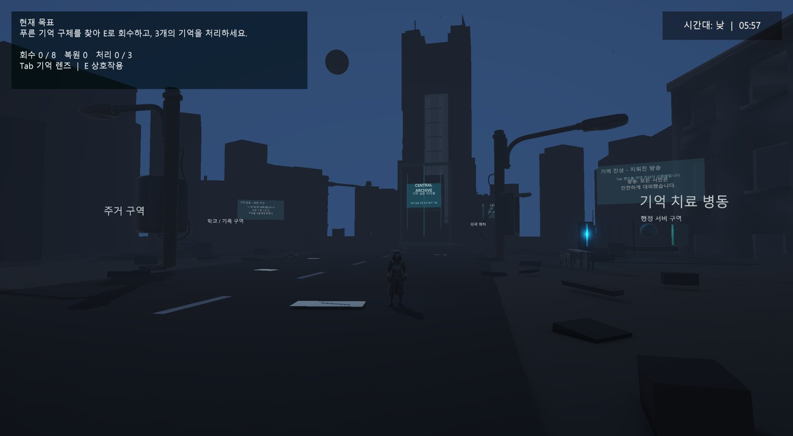
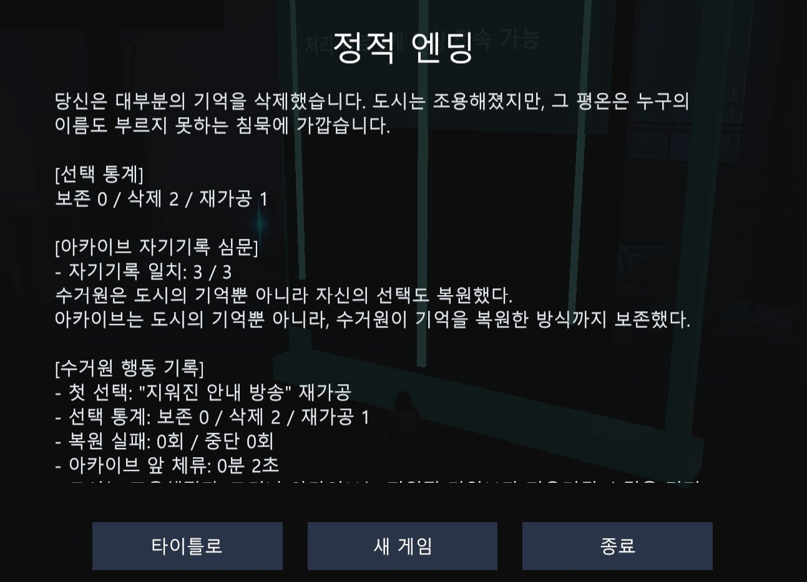
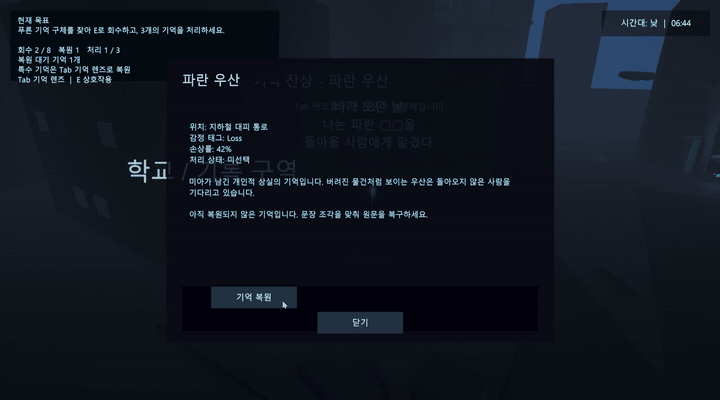
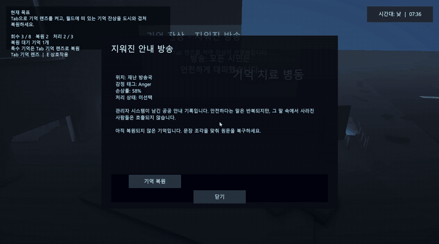
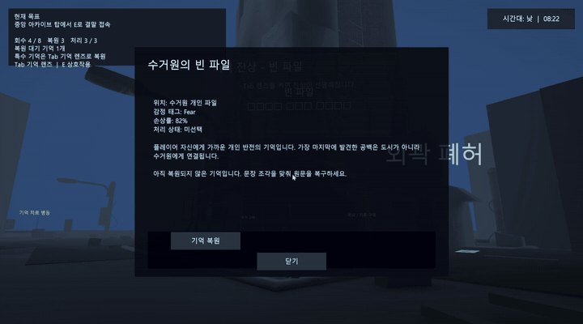

# Memory Recycler 3D

2인 팀 프로젝트입니다. [@junido7185](https://github.com/junido7185)는 기억 렌즈 퍼즐 3종·플레이어 행동 기록과 엔딩 반영·3인칭 캐릭터 접지를, [@wodnd0403](https://github.com/wodnd0403)는 씬 빌더·폐허 도시 확장·톤·음악·3D 에셋을 맡았습니다.

폐허가 된 도시에서 흩어진 기억을 회수하고, **기억 렌즈**로 월드에 떠 있는 잔상을 도시와 겹쳐 복원한 뒤, 그 기억을 보존·삭제·재가공할지 선택하는 3D 탐험 퍼즐 게임입니다.
마지막에 중앙 아카이브는 도시의 기억뿐 아니라 **플레이어가 어떻게 복원하고 선택했는지**까지 기록으로 돌려줍니다.

<p align="center">
  
</p>

> 이미지와 GIF는 2026-06-12 발표용으로 Unity Editor Game View에서 녹화한 실제 플레이 영상(`Docs/MemoryRecycler3D_Final_Presentation_SAFE.pptx`에 포함된 157초 영상)에서 포트폴리오 정리 중(2026-10-13) Claude Code로 잘라냈습니다.
> 전체 플레이 영상: [Docs/Portfolio/demo.mp4](Docs/Portfolio/demo.mp4) (2분 37초, 소리 없음)

| 항목 | 내용 |
|---|---|
| 형태 | 2인 팀 프로젝트 (학기 과제) · 2026.05 ~ 2026.06 (최종 발표 2026-06-12) |
| 팀 | [@junido7185](https://github.com/junido7185) (커밋 작성자명 `dev_slime`) · [@wodnd0403](https://github.com/wodnd0403) |
| 엔진 | Unity 6 (6000.3.12f1), URP, C# |
| 플레이 시간 | 5~10분, 기억 3개 처리 후 엔딩 |

저장소 이력은 2026-05-07 ~ 2026-08-03입니다. 마지막 두 커밋(2026-08-03, 폐허 도시 배치 보강)은 발표 이후 @wodnd0403가 추가했습니다.

## 플레이 흐름



| 도시 탐색 | 엔딩: 행동 기록 |
|---|---|
|  |  |

## 역할 분담

전체 145커밋 중 @wodnd0403 81개, @junido7185(`dev_slime`) 64개입니다(`git shortlog -sn main`). 줄 수는 현재 `main`에서 `git blame --line-porcelain main -- <파일>`의 `author` 줄을 세어 확인했습니다.

| 영역 | 담당 | 주요 파일 |
|---|---|---|
| 기억 렌즈 퍼즐 3종(정렬·가림·정지)과 판정 | @junido7185 | `World/MemoryLensEcho3D.cs` (468줄 전부), `UI/UIManager3D.cs`의 퍼즐 구간 |
| 플레이어 행동 기록과 엔딩 반영 | @junido7185 | `Memory/PlayerMemoryLog3D.cs` (463줄 전부), `UIManager3D`의 심문·엔딩 |
| 3인칭 캐릭터 접지·캡슐·애니메이션 연결 | @junido7185 | `Player/ThirdPersonPlayer3D.cs` 1,709줄 중 988줄, Mixamo 애니메이터 설정 |
| 카메라 충돌, 아카이브 터미널 상호작용, 플레이 경계 | @junido7185 | `OrbitCamera3D`, `ArchiveTerminal3D`, `PlayBoundary3D`, `MR3D_Bootstrap` |
| 맵 배치·충돌 검사 에디터 도구 | @junido7185 | `Editor/MR_ProposalMapCompositionPass.cs`, `Editor/MR_CollisionOverlapPass.cs` |
| 프로젝트 초기 구성, 씬 빌더, 폐허 도시 확장 | @wodnd0403 | `Editor/MemoryRecycler3DSceneBuilder.cs` (3,130줄 중 3,031줄), `World/ArchiveCityBackdropExpansion3D.cs` |
| 낮·밤 톤, BGM, 시네마틱 카메라, 시작·ESC 메뉴 | @wodnd0403 | `WorldToneController3D`, `MemoryRecyclerMusicManager`, `MemoryCinematicCamera3D` |
| 3D 건물·소품 에셋 생성과 배치 | @wodnd0403 | `ExternalAssets/Tripo`, `Tools/ModelGeneration` |

`UIManager3D.cs`(2,588줄)는 공동 작업이며 @junido7185 1,594줄, @wodnd0403 994줄입니다.

## 핵심 구현 (@junido7185 담당 부분)

### 1. 월드 공간 렌즈 퍼즐
기억 잔상은 월드에 놓인 Canvas이고, 퍼즐 판정은 "잔상을 화면 중앙에 얼마나 정확히 놓았는가"입니다.

```csharp
// World/MemoryLensEcho3D.cs:120-127 (발췌·주석 추가)
Vector3 viewport = camera.WorldToViewportPoint(GetFocusPosition());
if (viewport.z <= 0f) return false;                       // 카메라 뒤는 제외
normalizedDistance = Vector2.Distance(new Vector2(viewport.x, viewport.y), new Vector2(0.5f, 0.5f));
if (mode == MemoryPuzzleMode3D.LensOcclude)
    occluderHit = HasCenterStructure(camera);             // 화면 중앙 레이캐스트가 구조물에 닿아야 함
```

- **정렬(LensAlign):** 화면 중앙과의 거리(0~1 정규화)가 0.10 이하인 상태를 1.8초 유지하면 복원됩니다(`UI/UIManager3D.cs:1916-1926`, `:13`).
- **가림(LensOcclude):** 거리 0.12 이하이면서 화면 중앙 레이캐스트가 플레이어나 기억 구체가 아닌 콜라이더에 맞아야 합니다(`MemoryLensEcho3D.cs:365-380`). "지워진 안내 방송" 기억에 쓰이며, 잔상에 적힌 거짓 안내 방송("모든 시민은 안전하게 대피했습니다")을 도시 구조물과 겹쳐 가리면 그 아래 숨은 진실 문장("사라진 이름들은 안내문에 적히지 않았다")이 드러나는 연출입니다(`MemoryLensEcho3D.cs:427-430`).
- **정지(Stillness):** 잔상을 중앙에 둔 채 마우스 이동량이 1.5px를 넘거나 Tab 이외의 키·마우스 버튼을 누르면 초기화되고, 6초를 버티면 열립니다(`UIManager3D.cs:1945-1992`).
- 렌즈 대상이 없으면 문장 조각 퍼즐로 자동 대체되어 진행이 막히지 않습니다(`:1898-1901`).

| 정렬 | 가림 | 정지 |
|---|---|---|
|  |  |  |

### 2. 잔상이 다시 나타나지 않던 버그 (Claude Code와 함께 원인 분석·수정)
잔상이 자신을 `SetActive(false)`로 숨기면 그 오브젝트의 `Update`도 멈춰서 다시 켜질 조건을 검사할 수 없었습니다. 숨김을 `canvas.enabled` 토글로 바꾸고, 숨기는 조건을 "처리 완료"와 "거리 밖" 두 가지로만 제한했습니다(`MemoryLensEcho3D.cs:154-210`, 커밋 `8bedc3b`, `Co-Authored-By: Claude` 표기).

### 3. 선택을 기록해 엔딩으로 돌려주기
`PlayerMemoryLog3D`는 `[RuntimeInitializeOnLoadMethod]`로 씬 수정 없이 생성되고(`Core/MR3D_Bootstrap.cs:9-22`) `DontDestroyOnLoad`와 `PlayerPrefs`로 유지되는 기록기입니다(`Memory/PlayerMemoryLog3D.cs:58-83`).
첫 선택, 보존·삭제·재가공 횟수, 퍼즐 실패와 중단, 아카이브 앞에서 머문 시간을 저장하고, 엔딩에서 "아카이브는 그의 망설임까지 보존했다" 같은 문장으로 바꿔 보여줍니다(`PlayerMemoryLog3D.cs:260-302`).
엔딩 직전에는 중앙 아카이브가 플레이어 자신의 기록을 되묻는 2~3문항의 최종 질문(코드·문서상 "자기기록 심문")을 냅니다. 처음 처리한 기억, 처음 고른 처리 방식, 렌즈 퍼즐로 복원한 기억이 무엇이었는지 묻고(`UIManager3D.cs:1395-1480`), 맞힌 수를 "자기기록 일치: 2 / 3"처럼 엔딩에 표시합니다(`UIManager3D.cs:1574-1588`).
기록기 최초 구현(`26bf761`)과 심문 추가(`9f07838`) 커밋에는 `Co-Authored-By: Claude` 표기가 있습니다.

### 4. 애니메이션 모델이 뜨거나 묻히던 문제
Mixamo 모델을 붙이자 캡슐과 발 높이가 맞지 않아 걸을 때 발이 지면에서 뜨거나 파묻혔습니다. 하루(2026-06-05) 동안 휴머노이드 뼈 경계로 캡슐 자동 맞춤, 발가락 뼈 기준 접지, 렌더러 경계 기준 접지를 차례로 시도했지만 애니메이션 프레임마다 값이 흔들렸습니다.
최종적으로 런타임 자동 보정을 끄고 고정 오프셋 0.43m(`Player/ThirdPersonPlayer3D.cs:54`), 루트 모션·힙 고정, SphereCast 지면 탐지(`ThirdPersonPlayer3D.cs:910-963`)와 지면 스냅(`:976-996`)으로 단순화했습니다. 원인과 시도 과정은 [Docs/PLAYER_GROUNDING_QA.md](Docs/PLAYER_GROUNDING_QA.md)에 있습니다.

### 5. 뒤에서만 열리던 아카이브 터미널 (Claude Code와 함께 원인 분석·수정)
상호작용 트리거가 화면에 보이는 정면이 아니라 뒤쪽 깊이 1.6m 박스에 있었습니다. 터미널 중심 기준 수평 반경 5m 판정으로 바꾸고(`World/ArchiveTerminal3D.cs:36-98`), 판정 로그에 정면·후면·측면을 남겨 확인했습니다(`:100-145`, 커밋 `147fa9f`, `Co-Authored-By: Claude` 표기).

## 개발 방식

제 담당 부분의 구현에는 AI 코딩 에이전트(Claude Code, Codex)를 사용했습니다. 저는 작업 규칙([AGENTS.md](AGENTS.md): 수정 계획 먼저 제안, 씬·에디터 자동화 변경 금지, diff 확인 후 승인 시에만 커밋)과 수정 범위·QA 체크리스트를 정하고, 결과를 Unity 에디터 플레이와 체크리스트로 확인해 통합했습니다.
`Co-Authored-By: Claude` 표기가 있는 커밋은 `dev_slime` 커밋 64개 중 13개(2026-06-05 ~ 2026-06-11, 기능·수정 5개와 문서 8개)이며, @wodnd0403의 커밋 81개에는 이 표기가 없습니다.

## 실행 방법

1. Unity 6000.3.12f1로 저장소 루트를 엽니다.
2. `Assets/MemoryRecycler3D/Scenes/Prototype3D.unity`를 열고 Play 합니다.
3. 조작: WASD 이동, Shift 달리기, E 상호작용, Tab 기억 렌즈.

## 알려진 한계

- 가림(LensOcclude) 판정은 화면 중앙 레이캐스트가 처음 맞은 콜라이더가 플레이어·기억 구체만 아니면 통과합니다. 맞은 지점이 카메라와 잔상 사이에 있는지(`hit.distance`와 잔상까지의 거리 비교)는 확인하지 않아, 잔상 뒤쪽 건물이나 가까운 가로등도 "가림"으로 인정됩니다(`MemoryLensEcho3D.cs:365-380`).
- 정렬·가림 퍼즐 안내의 "중앙 거리 0px"는 0~1 정규화 값을 픽셀처럼 반올림해 출력하는 표시 버그입니다(`UIManager3D.cs:1936-1937`). 판정에는 영향이 없습니다.
- 자동 테스트는 없고, 검증은 체크리스트([Docs/PRE_DEMO_QA_CHECKLIST.md](Docs/PRE_DEMO_QA_CHECKLIST.md))와 발표 전 반복 플레이로 했습니다.
- 3D 건물·캐릭터 일부는 AI 3D 생성 도구(Tripo)로 만든 에셋이고, 캐릭터 애니메이션은 Mixamo입니다.
